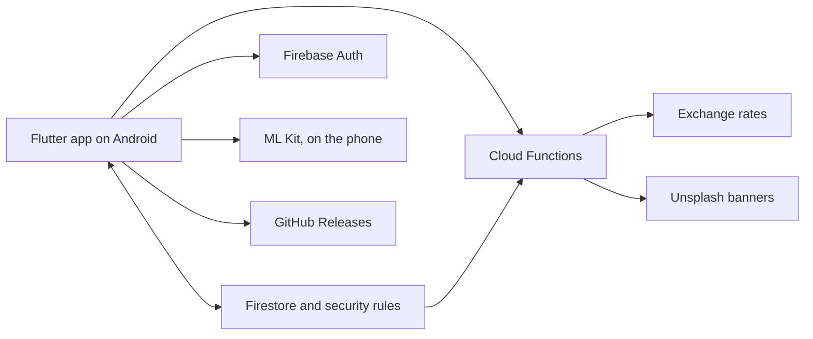

# Roamio

[](https://github.com/VarunParikh/Roamio/actions/workflows/ci.yml)
-3DDC84)

-FFA000)


**Split bills. Not friendships.**
*Instant peer splits. Zero awkward math.*

Roamio is a travel partner app for solo, couple and group travellers. Create an adventure, invite your squad with a link, log tabs (expenses) in any currency, and see who owes whom. It works offline, counts friends who don't have the app, and warns you privately when you near your own budget.

> **Roamio moves no money.** It records what people paid and owe. Settling up happens outside the app.

> **Status:** Android pilot build. The test release [`v0.1.0-rc1`](https://github.com/VarunParikh/Roamio/releases/tag/v0.1.0-rc1) is out as a pre-release, and the pilot with testers hasn't started. See [Status at a glance](#status-at-a-glance).

## Reviewer's map

| If you want to… | Open |
|---|---|
| **Run it** | [Setup](#setup), or the [pilot guide](docs/epics/roamio/release/pilot-guide.md) to install the APK |
| **Know what it is and why** | [Why Roamio exists](#why-roamio-exists), the [product vision](docs/core/product-vision.md) (the owner's brief), the [PRD](docs/epics/roamio/requirements/product-spec.md) |
| **Understand the design** | [How it works](#how-it-works), [architecture](docs/epics/roamio/design/architecture.md), [data model](docs/epics/roamio/design/data-model.md), [ADRs](docs/epics/roamio/design/adr/README.md) |
| **Check privacy and honesty** | [Known limitations](docs/epics/roamio/release/known-limitations.md), [privacy notice](docs/epics/roamio/release/privacy-notice.md), [security review](docs/epics/roamio/verify/reviews/security-2026-10.md) |
| **Trace requirements to tests** | [User stories](docs/epics/roamio/requirements/user-stories.md), [test plan](docs/epics/roamio/verify/test-plan.md) |
| **Follow the decisions** | [Conflicts log](docs/core/open-conflicts.md), [approval register](docs/core/approval-register.md), [roadmap](docs/core/roadmap.md) |
| **Release it** | [Release checklist](docs/epics/roamio/release/release-checklist.md), [RELEASING.md](docs/RELEASING.md) |
| **Continue the work** | [`CLAUDE.md`](CLAUDE.md), [task list](tasks/todo.md), [handover](tasks/HANDOVER.md) |

## Why Roamio exists

Shared trips make money awkward: several currencies, several people paying, friends without the app, poor connections, and a spreadsheet at the end. Roamio aims to end the trip with a split everyone agrees with, and without that spreadsheet.

This is the owner's premise. It hasn't been tested with users, and the pilot is how it gets tested.

## Status at a glance

As of 2026-11-01.

| Area | Position |
|---|---|
| App tests | 921 pass |
| Journeys on emulators | 8 of 8 pass, plus 2 bill-reading tests |
| GitHub's checks | Green on `main` through #125 |
| Prod backend and website | Deployed |
| Test release on a real phone | Installs, and Google sign-in works (owner's report) |
| Pilot with testers | Not started |
| Bill-scan accuracy | Not measured on bills the fix wasn't built around |

Everything limited or unproven: **[known limitations](docs/epics/roamio/release/known-limitations.md)**. What's left: **[release checklist](docs/epics/roamio/release/release-checklist.md)**.

## What it does

- **Adventures and squads:** invite by link or code, promote co-leads, and add pals without the app.
- **Tabs:** any currency, several payers, equal or custom percentage splits, and how each person paid.
- **Approval:** admins approve shared tabs before they count. Personal tabs stay yours alone.
- **Split:** your spend, who pays whom in the fewest transfers, and spend by category and day.
- **Mark as settled:** record a payment in any currency.
- **Private budget:** only you can read it, with alerts at 80% and 100%.
- **Scan bill:** reads a bill on the phone and fills in what it trusts. You confirm it, and nothing is uploaded.
- **Offline:** add and edit while offline, and it syncs by itself.
- **Your data:** download it or delete your account from the Privacy centre.
- **Updates:** the app checks GitHub Releases and offers new versions.

Under-18 accounts, uploading your own pictures, Raise a concern and in-app Nominate are built but switched off for the pilot: see the [roadmap](docs/core/roadmap.md).

## How it works



- **Money** is integer minor units, and percentages are basis points. Balances always sum to exactly zero.
- **Security rules** are the privacy boundary, with allow and deny tests for every rule.
- **Cloud Functions** handle anything that must be trusted, such as joining and role changes.
- **All Firebase resources** are in asia-south1 (Mumbai).

More diagrams: [architecture](docs/epics/roamio/design/architecture.md).

## Setup

Full machine setup (Flutter through FVM, both JDKs, Android SDK, emulator, Firebase CLI) is in **[docs/SETUP.md](docs/SETUP.md)**.

| Part | Folder | Needs |
|---|---|---|
| Android app | `app/` | Flutter pinned in `app/.fvmrc`, JDK 17 |
| Backend | `firebase/` | Node, Firebase CLI, JDK 21 for the emulators |

`google-services.json` is never committed. Download it as SETUP.md describes.

```bash
cd app && fvm flutter run --flavor dev
```

## Tests

App (the same checks as CI):

```bash
cd app && fvm dart format --set-exit-if-changed . && fvm flutter analyze && fvm flutter test
```

Backend (rules and functions, against emulators):

```bash
cd firebase && JAVA_HOME=/opt/homebrew/opt/openjdk@21 npm test
```

Journeys (real app on an Android emulator, against Firebase emulators):

```bash
JAVA_HOME=/opt/homebrew/opt/openjdk@21 PATH=/opt/homebrew/opt/openjdk@21/bin:$PATH ./tool/e2e.sh integration_test/journeys_test.dart
```

CI runs the app and backend checks on every pull request, and the journeys nightly on `main`.

## Releases

A release is a signed APK on [GitHub Releases](https://github.com/VarunParikh/Roamio/releases). Pushing a tag such as `v1.2.3` starts a build that waits for the owner's approval. A tag such as `v1.2.3-rc1` becomes a pre-release, which the app's update popup ignores. Steps: [RELEASING.md](docs/RELEASING.md).

## Repository map

| Path | Contents |
|---|---|
| `app/` | Flutter app: `lib/core/`, `lib/features/<feature>/{data,domain,ui}`, tests and journeys |
| `firebase/` | Security rules, Cloud Functions, Hosting pages and their tests |
| `docs/core/` | Vision, constitution, strategy, platforms, roadmap, conflicts log, approval register, glossary |
| `docs/epics/roamio/` | Discovery, requirements (BRD, PRD, user stories), design, verification and release |
| `docs/inputs/` | The owner's original brief |
| `docs/SETUP.md`, `RELEASING.md`, `REMOTE_CONFIG.md` | How-to guides |
| `design/` | [DESIGN.md](design/DESIGN.md), reference screens and the app icon |
| `data/` | Countries, currencies and expense categories |
| `tasks/` | Plan, task list, handover, screen-state checklist |
| `tool/` | `e2e.sh` journey runner |
| `.github/workflows/` | CI, nightly journeys and release |

## Roadmap

1. **Phase 1:** Android pilot with 10 users
2. **Phase 2:** Web app, plus the features held back from the pilot
3. **Phase 3:** iOS app and Sign in with Apple

Details: [roadmap](docs/core/roadmap.md).

## Known limitations (short version)

- **Scan bill accuracy isn't measured,** and a finished scan coming back into the app is unproven.
- **Android only, English only, sideloaded,** so Play Protect may warn on install.
- **The privacy notice names the owner with no email address** during the pilot. It needs review before any wider launch.
- **Some place names and shop names read oddly,** with fixes planned for phase 2.

The full list: [known limitations](docs/epics/roamio/release/known-limitations.md).

## Data and secrets

- **Secrets:** `google-services.json`, keystores and `.env` files are never committed. Release secrets live in a GitHub environment that needs the owner's approval.
- **Personal data:** see the [privacy notice](docs/epics/roamio/release/privacy-notice.md).
- **Licence:** none has been chosen yet, so all rights are reserved by default.
