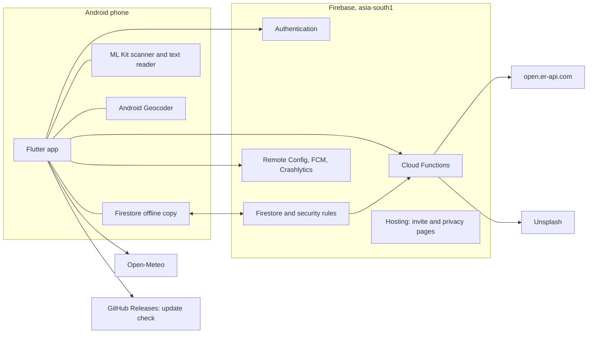
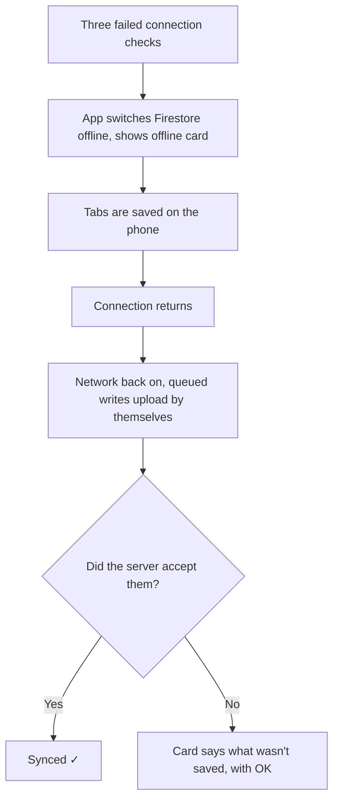
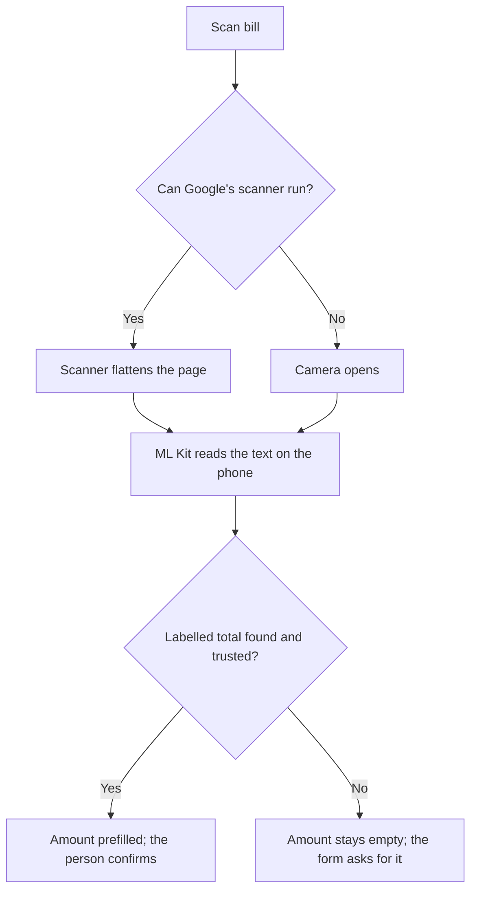
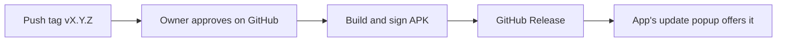

# Architecture: Roamio

Status: APPROVED (owner, 2026-11-01), written 2026-11-01 from the [spec](../requirements/product-spec.md), [plan](../../../../tasks/plan.md), [ADRs](adr/README.md) and the code.

## System

## Main decisions

| Decision | Why | Where |
|---|---|---|
| Feature-first Flutter layout, with pure Dart in `domain/` | The riskiest logic can be tested on its own | `app/lib/features/<feature>/` |
| Money in integer minor units, percentages in basis points | No rounding errors | Spec §6 |
| Security rules are the privacy boundary | The UI can't be trusted to guard data | `firebase/firestore.rules` |
| Cloud Functions for anything that must be trusted | The client can't grant itself a role | `firebase/functions/src/` |
| Firestore's own offline queue | Avoids building a sync engine | [ADR-002](adr/ADR-002-offline-sync-model.md) |
| Two Firebase projects | Testing never touches real data | [Platforms](../../../core/product-platforms.md) |
| Features held back behind switches | Code stays built and tested | `app/lib/core/config/phase2.dart` |

## Offline and sync

## Adding a tab with Scan bill

Nothing from the scan is uploaded or kept in the pilot.

## Data
See the [data model](data-model.md).

## Release

A tag such as `v0.1.0-rc1` becomes a pre-release, which the popup ignores.
